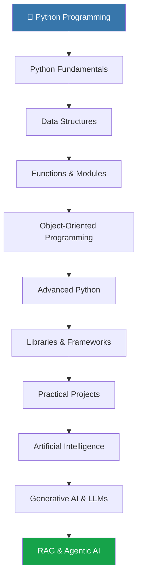
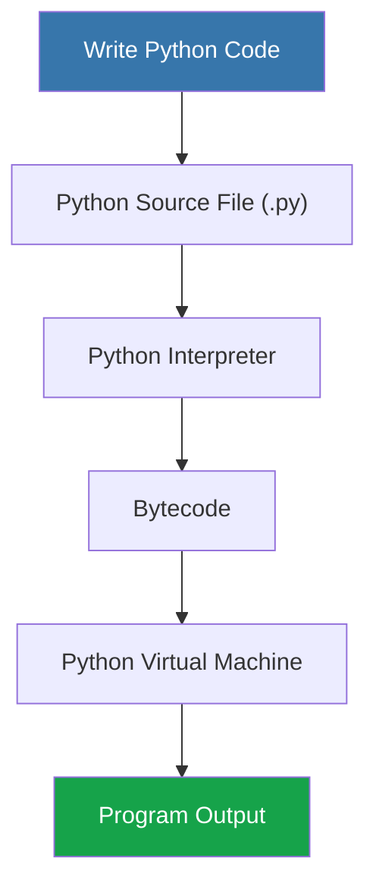

# 🐍 Python Learning Journey

<p align="center">
  
  
  
</p>

<p align="center">
  <b>Learn • Practice • Build • Improve</b>
</p>

---

## 📌 About This Repository

Welcome to my **Python Learning Repository**! 

This repository documents my journey of learning Python, starting from fundamental programming concepts and gradually progressing towards advanced topics and real-world applications.

The main objective is to understand Python concepts through simple explanations, practical code examples, problem-solving exercises, and hands-on projects.

This repository will serve as my personal learning notebook, where I continuously add new concepts, practice programs, and projects.

My long-term goal is to use Python for **Artificial Intelligence, Generative AI, Machine Learning, RAG, LLMs, and Agentic AI.**

---

## 🗺️ Python Learning Roadmap

The following diagram represents my learning path:



---

## 📚 Topics Covered

### 01. Python Fundamentals
- Introduction to Python
- Variables and Data Types
- Operators and Expressions
- Input and Output
- Conditional Statements (if, elif, else)
- Loops (for and while)
- Break, Continue and Pass
- Type Conversion

### 02. Python Data Structures
- Strings and String Methods
- Lists and List Operations
- Tuples
- Sets
- Dictionaries
- List Comprehensions
- Nested Data Structures

### 03. Functions and Modules
- Function Definition and Calling
- Parameters and Arguments
- Return Statements
- Default and Keyword Arguments
- Lambda Functions
- Recursion
- Scope of Variables
- Modules and Packages

### 04. Object-Oriented Programming (OOP)
- Classes and Objects
- Constructors
- Instance and Class Variables
- Inheritance
- Encapsulation
- Polymorphism
- Abstraction
- Method Overriding

### 05. Advanced Python
- Exception Handling
- File Handling
- Iterators and Generators
- Decorators
- Context Managers
- Virtual Environments
- Working with External Libraries
- Python Type Hints

### 06. Python Libraries and Tools
- NumPy
- Pandas
- Matplotlib
- Requests
- FastAPI
- Flask
- Pydantic

### 07. AI and Generative AI
- Introduction to Artificial Intelligence
- Machine Learning Fundamentals
- Deep Learning Basics
- Large Language Models (LLMs)
- Prompt Engineering
- LangChain
- Retrieval-Augmented Generation (RAG)
- AI Agents and Agentic AI

---

## 🧠 How Python Code Works

A simple overview of how a Python program executes:



---

## 💻 Getting Started

Follow these steps to run Python programs on your local machine.

**1. Install Python**

Download Python from the official website:

https://www.python.org/downloads/

**2. Verify Installation**

```bash
python --version
```

**3. Clone This Repository**

```bash
git clone https://github.com/YOUR-USERNAME/YOUR-REPOSITORY.git
```

**4. Navigate to the Repository**

```bash
cd YOUR-REPOSITORY
```

**5. Run a Python File**

```bash
python filename.py
```

---

## 📂 Repository Structure

```text
Python-Learning/
│
├── 01-Python-Fundamentals/
│   ├── variables.py
│   ├── data_types.py
│   ├── operators.py
│   ├── conditions.py
│   └── loops.py
│
├── 02-Data-Structures/
│   ├── strings.py
│   ├── lists.py
│   ├── tuples.py
│   ├── sets.py
│   └── dictionaries.py
│
├── 03-Functions-and-Modules/
│
├── 04-OOP/
│
├── 05-Advanced-Python/
│
├── 06-Libraries-and-Tools/
│
├── 07-AI-and-Generative-AI/
│
├── 08-Practice/
│
├── 09-Projects/
│
└── README.md
```

---

## 📝 Learning Progress

Tracking my progress topic by topic.

- [ ] Python Fundamentals
- [ ] Data Structures
- [ ] Functions and Modules
- [ ] Object-Oriented Programming
- [ ] Advanced Python
- [ ] Python Libraries
- [ ] Problem Solving
- [ ] Mini Projects
- [ ] Machine Learning Fundamentals
- [ ] Generative AI
- [ ] RAG and LLMs
- [ ] Agentic AI

---

## 🎯 My Learning Goals

- Build a strong foundation in Python programming.
- Improve logical thinking and problem-solving skills.
- Understand Object-Oriented Programming.
- Write clean, readable, and reusable code.
- Learn Python libraries and frameworks.
- Explore Artificial Intelligence and Machine Learning.
- Build practical AI-powered applications.
- Understand RAG, LLMs, and Agentic AI.

---

## 📖 Useful Learning Resources

| Resource | Link |
|---|---|
| Python Official Documentation | https://docs.python.org/3/ |
| Python Official Website | https://www.python.org/ |
| W3Schools Python | https://www.w3schools.com/python/ |
| Real Python | https://realpython.com/ |
| Programiz Python | https://www.programiz.com/python-programming |
| GeeksforGeeks | https://www.geeksforgeeks.org/python/python-programming-language-tutorial/ |

---

## 🚀 Learning Philosophy

Learning programming is not just about remembering syntax. It is about understanding concepts, developing logic, solving problems, and building things.

I believe in learning one concept at a time, practicing it with code, making mistakes, understanding them, and improving continuously.

This repository is a record of my learning journey, experiments, progress, and projects.

**One step at a time. One concept at a time. One program at a time.**

<p align="center">
  <b>🐍 Keep Learning. Keep Coding. Keep Building!</b>
</p>

